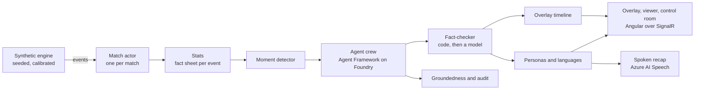

# Pitchside

**Explainable match intelligence for broadcast, built on synthetic football data that is measured, not asserted.**

Pitchside is Maribo Devs' entry to the Microsoft and Premier League *Inside the Game* developer hackathon,
declared in the **Best Enterprise Solution** category. It ingests a live stream of synthetic match events,
turns them into statistics and patterns, explains why a moment matters, renders that as a timed overlay beside
the match, and personalises it for an analyst, a casual fan, a club fan and a player-focused viewer, in
several languages.

**Live demo:** <https://pitchside-web.proudground-3a2deeab.southafricanorth.azurecontainerapps.io>. A match is always
on air: the demo plays seed 26 on a loop at ten times real time, about 13 minutes a match, with the overlay, the
viewer and the control room one click from the match list.

One rule shapes the whole system: **numbers come from code, words come from AI, and every word cites the
numbers it came from.** A narrative sentence that contains a number not on the fact sheet is rejected before
it reaches a screen.

## What is built

| Piece | Work package | State |
| --- | --- | --- |
| Synthetic engine: fictional Meridian League, 20 clubs, seeded possession-level simulation | WP-00 | built |
| Stats layer: one fact sheet per event, every number a fact with an id | WP-01 | built |
| Moment detection: twelve rules, rate limited, golden master for seed 7 | WP-02 | built |
| Live runtime: one Akka.NET actor per match, Event Hubs or in-process bus, Cosmos DB or in-memory store, SignalR | WP-03 | built |
| Agent crew on Microsoft Agent Framework: explainer, fact-checker, template fallback | WP-04 | built |
| Overlay timeline, Angular overlay, viewer and control room | WP-05 | built |
| Personas (analyst, casual, club fan, player focus) in English, Afrikaans, isiZulu and Spanish | WP-06 | built |
| Evaluation, traceability, usage guard, audit of every model call | WP-07 | built |
| MCP server: match state as tools for agents and Copilot | WP-08 | built |
| Bicep, azd, Container Apps, deploy workflow | WP-09 | deployed: dev and demo environments, one deploy identity each |
| Spoken full-time recap with Azure AI Speech | WP-10 | deployed: real neural voices in all four languages |
| Demo seed, jump to the next moment, submission | WP-11 | demo live; video and submission in progress |
| Fabric Real-Time Intelligence: Eventstream, KQL database, dashboard, pressure alert in Activator | WP-12 | deployed on dev |

The state of record, with the evidence for each row, is the
[gap register](docs/specs/IMPLEMENTATION-GAP.md). The plan by day and owner is in [docs/PLAN.md](docs/PLAN.md).

## Evidence

- **Realism.** [The calibration report](docs/calibration/report.md) compares 5,000 simulated matches with the
  real league's averages: all 26 statistics are within tolerance. CI regenerates it and fails on drift.
- **Every number cited.** [The evaluation report for MER-7](docs/evaluation/report-MER-7.md) is a run on the
  Foundry deployments: 752 narratives from 34 moments and 1,412 model calls. The fact-checker verified 315, rejected
  184, and 253 fell back to a template written by code, so no rejected sentence reaches a screen. Mean citation
  coverage is 0.994 and mean Foundry groundedness 0.702.
- **The live demo.** Three consecutive demo loops on 23 October each had 1,537 events, the 29 moments in
  [docs/DEMO.md](docs/DEMO.md), 656 narratives written on Foundry (1 to 4 template fallbacks for the base card),
  all 29 cards aired, and a spoken recap in each language. Every route passed a no-sideways-scroll check at 360,
  768 and 1,280 px.
- **Fabric.** [docs/FABRIC.md](docs/FABRIC.md#evidence): the KQL database matched the API's event count on every
  replay, the momentum tile matched the overlay, and the pressure alert fired at the minute the simulation
  predicted.
- **Determinism.** Pinned seeds are golden masters: the sample match's events, its 34 moments and its 752
  narratives are compared exactly on every build.
- **The demo match.** [docs/DEMO.md](docs/DEMO.md) records how seed 26 was chosen from 500 for drama, with its
  moment list.

## How it fits together



[docs/ARCHITECTURE.md](docs/ARCHITECTURE.md) has the stages, the agent crew, the enterprise controls and the
Azure topology.

## Why the data is different

No dataset is provided by the hackathon. Every entrant generates their own and most assert it is realistic.
Pitchside measures it. [`data/calibration/targets.json`](data/calibration/targets.json) holds league-level
averages from the English top flight, 2015/16 to 2025/26, 4,230 matches: goals, result split, shots, shots on
target, corners, fouls, cards, first-half share. The engine is tuned until a season-scale sample matches every
one of them within a stated tolerance, and CI fails if it drifts. Read [docs/CALIBRATION.md](docs/CALIBRATION.md)
for the method and what it does not claim.

Everything in the data is fictional. No real club, player, competition or venue appears anywhere.

## Run it

Everything runs locally with no cloud account: the scripted crew, the in-memory store and the in-process bus.

```bash
dotnet build Pitchside.slnx
dotnet test Pitchside.slnx

# one seeded match: match.json and events.jsonl
dotnet run --project src/Pitchside.Cli -- simulate --seed 7 --out out/seed-7

# the calibration report, the moments and the narratives of a match
dotnet run --project src/Pitchside.Cli -- calibrate --matches 5000
dotnet run --project src/Pitchside.Cli -- moments --seed 7
dotnet run --project src/Pitchside.Cli -- narrate --seed 7 --provider scripted --personas all --languages en,af,zu,es

# the evaluation report and the demo seed
dotnet run --project src/Pitchside.Cli -- evaluate --match MER-7 --provider local
dotnet run --project src/Pitchside.Cli -- demo-seed --from 1 --to 500

# the API on http://localhost:5180, then the UI on http://localhost:4200
dotnet run --project src/Pitchside.Api --urls http://localhost:5180
cd frontend && npm ci && npx ng serve

# everything under Aspire (needs the Aspire workload or CLI on your machine)
dotnet run --project src/Pitchside.AppHost
```

Start a replay from the home page, or `POST /api/v1/replays { "seed": 26, "speed": 1 }`, then open the viewer or
the control room. A committed sample match lives in [`data/samples/seed-7`](data/samples/seed-7); CI regenerates
it and diffs. Every setting is in [docs/CONFIGURATION.md](docs/CONFIGURATION.md).

## Microsoft and Azure technologies

The integration matrix in [docs/MICROSOFT-INTEGRATION.md](docs/MICROSOFT-INTEGRATION.md) names what each
hero technology does in Pitchside and whether it is planned, built or deployed. It is kept honest: a row only
says built when a commit made it true.

## Documents

- [docs/HACKATHON.md](docs/HACKATHON.md): the rules distilled, criteria, dates, submission checklist
- [docs/ARCHITECTURE.md](docs/ARCHITECTURE.md): the five stages, the agent crew, enterprise controls, Azure topology
- [docs/EVENT-SCHEMA.md](docs/EVENT-SCHEMA.md): the event contract
- [docs/CALIBRATION.md](docs/CALIBRATION.md): how realism is measured
- [docs/PERSONAS.md](docs/PERSONAS.md): the viewer modes and their acceptance criteria
- [docs/PLAN.md](docs/PLAN.md): the day-by-day plan
- [docs/MCP.md](docs/MCP.md): the MCP server and how to register it
- [docs/DEMO.md](docs/DEMO.md): the demo match
- [infra/README.md](infra/README.md): the Azure resources and how to deploy them
- [docs/specs/](docs/specs/README.md): the build contract, one document per work package, and the gap register

## Team

| | Role |
| --- | --- |
| Sipho Maribo | Senior software architect: engine, agents, infrastructure |
| Pretty Kunene | Tester: evaluation harness, fact-check gate, golden masters, browser gates |
| Hlumela Tshazibana | Project manager and business analyst: personas, pitch, video, submission |

## How it is built

Pitchside is developed with GitHub Copilot agent mode and Claude Code alongside the team. Every design
decision, calibration target, tolerance and test is the team's. AI-assisted commits carry co-author trailers.

## License

MIT. See [LICENSE](LICENSE).
