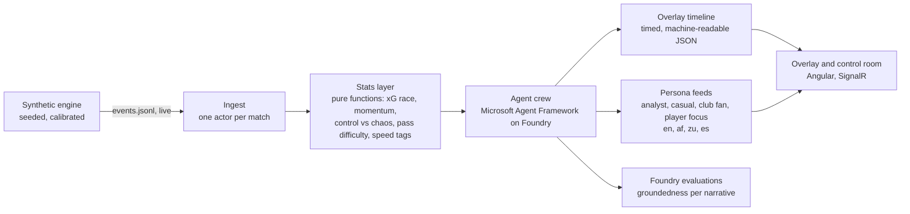
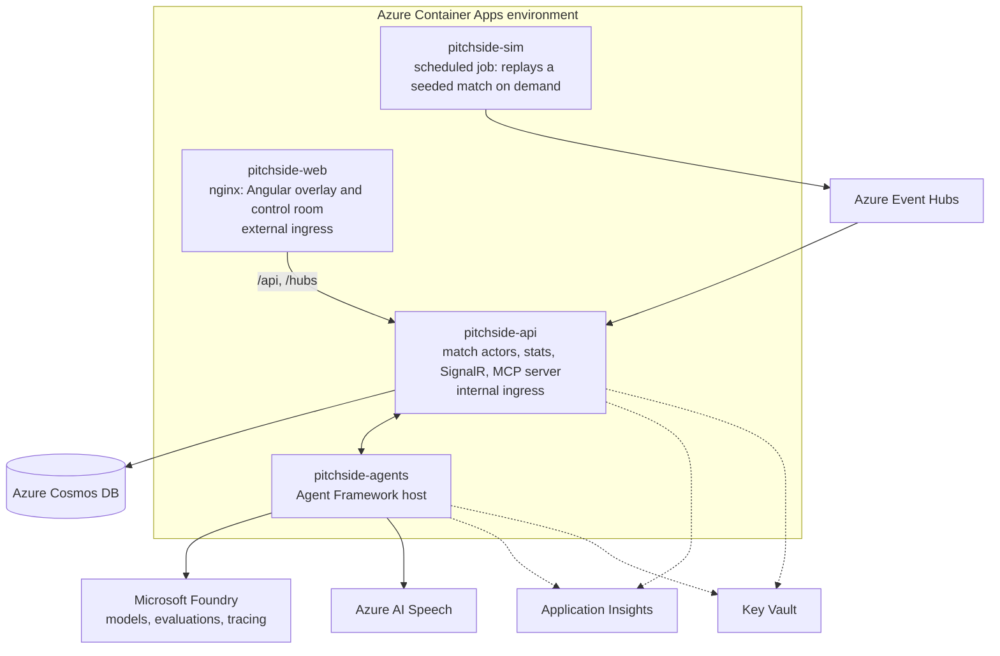

# Architecture

Pitchside turns a live stream of synthetic football events into explainable, personalised, broadcast-ready
match intelligence. The rule that shapes everything: **numbers come from code, words come from AI, and every
word cites the numbers it came from.**

## The five stages



| Stage | Component | Owner |
| --- | --- | --- |
| Ingest | `Pitchside.Engine` publishes; a match actor (Akka.NET) holds live state and fans out over SignalR and Event Hubs | Sipho |
| Interpret | `Pitchside.Stats`: deterministic metrics, no model calls | Sipho, tests by Pretty |
| Explain | Agent crew: moment detector, explainer, fact-checker | Sipho |
| Render | Overlay timeline JSON with in and out times, slots, layers; Angular overlay | Sipho |
| Personalise | Persona writer and translator agents; viewer preferences | Sipho, personas by Hlumela |

## Agent crew

Built on Microsoft Agent Framework (.NET), hosted through Microsoft Foundry.

| Agent | Role | Input | Output | Failure behaviour |
| --- | --- | --- | --- | --- |
| Stats | Code, not a model. Freezes a fact sheet at each moment | Events | Fact sheet with ids | Cannot fail; pure |
| Moment detector | Decides *that* a moment matters, by rule and threshold, attaching evidence | Fact sheet | Moment with evidence ids | Rules only; no model |
| Explainer | Writes *why* it matters, citing fact-sheet ids | Moment | Draft narrative with citations | Retry once, then scripted template |
| Fact-checker | Verifies every claim against the fact sheet; rejects uncited numbers | Draft | Verified narrative or rejection | Rejection falls back to template |
| Overlay scheduler | Slots verified moments into the timeline without collisions | Verified narratives | Overlay timeline entries | Deterministic |
| Persona writer | Rewrites for analyst, casual, club fan, player focus | Verified narrative | Per-persona text | Falls back to base narrative |
| Translator | Renders each persona text in the viewer's language | Persona text | Localised text | Falls back to English |

Shared state is the match actor's fact sheet. Handoffs are typed messages. The template card airs first, so the
broadcast never waits on a model.

## Enterprise controls

These are the Best Enterprise Solution argument, and each one is visible in the UI or the repo:

- Traceability: every narrative sentence links to the event ids it cites; the control room shows the chain.
- Evaluation: Foundry evaluations score groundedness; the score is displayed, and the README reports the pass
  rate over the sample season.
- Golden masters: the engine's output for pinned seeds is frozen in tests, as in our underwriting engine work.
- Usage guard: caps on concurrent replays, narratives per hour and spoken lines, so the public demo cannot be
  run up by a stranger.
- Secrets: Key Vault references and managed identity only.
- Observability: OpenTelemetry from every service, Aspire dashboard locally, Application Insights in Azure.
- Infrastructure as code: Bicep and azd, reviewed like any other change.

## Azure topology



## Repository layout

```
src/
  Pitchside.Contracts/      event and match records, the schema's C# twin
  Pitchside.Engine/         synthetic engine: clubs, players, possession model, calibration
  Pitchside.Cli/            simulate, calibrate, replay
  Pitchside.ServiceDefaults/ OpenTelemetry, health, resilience (Aspire)
  Pitchside.Api/            match actors, stats, SignalR hub, MCP server (minimal today)
  Pitchside.AppHost/        Aspire orchestration
tests/
  Pitchside.Engine.Tests/   determinism, schema, calibration gates
docs/                       the documents in this folder
schemas/                    JSON Schema for match.json and events.jsonl
data/calibration/           real-league targets (aggregates only)
data/samples/               a committed seeded match for reviewers and tests
```
