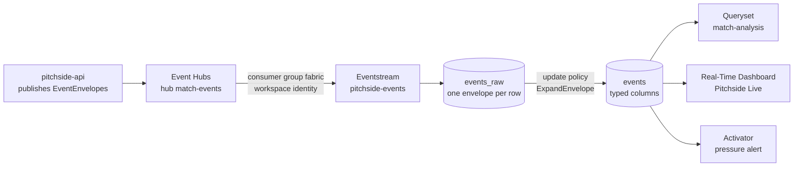

# Microsoft Fabric Real-Time Intelligence (WP-12)

The live event feed lands in Fabric, so an analyst can query a match with KQL and a studio can watch a real-time
dashboard, the way a league's data team would. The specification is
[specs/WP-12-fabric.md](specs/WP-12-fabric.md). This page is the design, the portal steps a person performs, the order
the local session runs things in, and the evidence.

## Design



| Piece | Where it is defined | How it gets to Fabric |
| --- | --- | --- |
| `fabric` consumer group, the workspace identity's read access | `infra/modules/eventhubs.bicep` | `azd provision` |
| Eventhouse `pitchside` and KQL database `pitchside` | `infra/scripts/fabric-apply.sh` | the script, Fabric REST API |
| Tables `events_raw` and `events`, the JSON mapping, the update policy | `fabric/kql/schema/` | the script, as the database's `DatabaseSchema.kql` |
| The six saved queries, as stored functions | `fabric/kql/queries/` | the same |
| The Activator's source query `PressureAlerts` | `fabric/activator/pressure-alerts.kql` | the same |
| KQL queryset `match-analysis` | `fabric/queryset/match-analysis.json` | the script, `RealTimeQueryset.json` |
| Real-Time Dashboard `Pitchside Live` | `fabric/dashboard/pitchside-live.json` | the script, `RealTimeDashboard.json` |
| Eventstream `pitchside-events` | portal, below | its connection is created in the portal |
| Activator `pitchside-alerts` | portal, [fabric/activator/README.md](../fabric/activator/README.md) | exported back with `--export-activator` |
| Optional F2 capacity | `infra/modules/fabric.bicep` | `azd provision` with `PITCHSIDE_FABRIC_CAPACITY=true` |

### The feed and how dev reads it

The API publishes every event as an `EventEnvelope` (`matchId`, `seq`, `type`, `payloadJson`, `publishedUtc`,
camelCase, `docs/EVENT-SCHEMA.md`) to the hub `match-events`, partitioned by match id. The Eventstream reads the hub
with its own consumer group, `fabric`.

**dev runs Event Hubs Standard.** Basic holds only `$Default`, and the API's ingest reads `$Default` with an
`EventProcessorClient`, which holds every partition with an exclusive (epoch) receiver. A second reader in the same
group is disconnected, so Fabric cannot share it. Standard holds the `api`, `agents` and `fabric` groups that
`eventhubs.bicep` already declares. Moving dev from Basic to Standard is an in-place upgrade of the namespace. The
agent host's scaler keeps following `$Default` while the crew runs in the API (`runAgentsInApi`), because nothing
reads the `agents` group then and its lag would never drain. demo stays on Basic and has no Fabric feed (see the pull
request's decisions).

**No key.** The namespace keeps local auth disabled. The Eventstream's Event Hubs source authenticates with the Fabric
**workspace identity**, which `eventhubs.bicep` grants Azure Event Hubs Data Receiver on the hub only, once its
object id is set (`FABRIC_WORKSPACE_PRINCIPAL_ID`). The spec's fallback, a Listen-only SAS rule kept in Key Vault, would
need local auth turned back on for the whole namespace, so it is not built; if the workspace-identity source fails
in this tenant, that is a decision for the owner.

### Tables

`events_raw` receives the envelopes as they are, through the JSON mapping `envelope`, and keeps them 3 days. The update
policy runs `ExpandEnvelope()` on every ingestion into `events_raw` and writes one row per event into `events`:

| Columns | From |
| --- | --- |
| `matchId, seq, period, clockMs, type, teamId, playerId, x, y, xg, outcome, difficulty, lengthM, speedKph, publishedUtc` | the fifteen the spec names; `x` and `y` are `location.x` and `location.y`, `publishedUtc` is the envelope's |
| `eventId, wallTimeUtc, possessionId, completed, onTarget, endX, endY, tracking` | the other fields the queries need to agree with `Pitchside.Stats`: completed passes, shots on target, where a pass or carry ended (final-third entries), the tracking ticks (top speeds) |
| `payload` | the whole event, for anything else |

Every field comes from `schemas/event.schema.json`; `KqlScriptTests` fails if the update policy reads a field the
schema does not define, if its columns drift from the table's, or if the landing table drifts from the envelope the
bus serialises.

The Eventstream delivers at least once, so a message can land twice. Every query reads a match through
`MatchEvents(matchId)`, which keeps one row per `seq`.

### Saved queries

Each is a stored function in the database, so the queryset, the dashboard and anyone with KQL run the same text.
Each mirrors the `Pitchside.Stats` definition of the fact the overlay shows.

| Function | Shows | Mirrors |
| --- | --- | --- |
| `ShotsBySide(matchId)` | shots per side per 5 minutes, labelled by half (`H1 40-45`) | `{side}.shots` |
| `XgRace(matchId)` | cumulative xG per side after every shot, from 0 at kick-off | `{side}.xg` |
| `PassCompletionByPlayer(matchId)` | passes, completed passes and the share per player | `player.<id>.passCompletion` |
| `PressingIntensity(matchId)` | pressures per opponent pass over the last 10 minutes, per minute | `{side}.pressingIntensity` |
| `MatchMomentum(matchId)` | each side's share of the weighted sum over the last 5 minutes, per minute | `match.momentum.*` |
| `TopSpeeds(matchId)` | the ten fastest players | `player.<id>.topSpeedKph` |

Momentum uses the WP-01 weights (shot 3, on target 4 more, 10 per unit of xG, corner 2, final-third entry 1), the
same final-third line (x 70) and the same 5-minute window that never crosses half time. `MomentumParityTests` reads
the KQL constants and runs `EventRules.MomentumWeight` on probe events, and fails if any weight, the line or the window
differs, or if the C# rule starts weighting another event type. The pressing window is checked against
`EventRules.TenMinutesMs` the same way.

Helpers: `Matches()` (every match, latest first, the dashboard's selector), `MatchEventCount(matchId)` (the evidence
check), `MatchEvents(matchId)`.

### Dashboard

`Pitchside Live`, one page, auto-refresh every 30 s, a **Match** selector (`_matchId`, listing every match latest
first and defaulting to `MER-13`, the alert demonstration: the dashboard loader takes only a fixed default) and six tiles: momentum and xG race (lines over match time), shots per 5 minutes (columns), pressing intensity
(line), pass completion by player (table), top speeds (bars). The committed file holds three placeholders the apply
script fills: `{{WORKSPACE_ID}}`, `{{DATABASE_ID}}` (the KQL database item) and `{{QUERY_SERVICE_URI}}` (the
Eventhouse's query URI). `DashboardDefinitionTests` checks the load rules Fabric enforces: RFC 4122 ids, each query
referenced exactly once, every variable a parameter, every called function present in the KQL.

### Activator

The rule "a side's shots in any 3-minute window reach 4" watches `PressureAlerts()`, which uses the
`sustained_pressure` moment's window. The rule itself is built in the portal and exported; the reasons and the exact
definition are in [fabric/activator/README.md](../fabric/activator/README.md).

### Capacity

dev runs on the trial capacity `2f03905a-f931-496e-8e8c-49485a21c5a5`, workspace `pitchside-dev`
(`74e1627c-0077-4c79-a543-84c9af743169`), until the trial ends around 13 December, after judging
(`docs/ENVIRONMENT.md`). `fabric.bicep` can add an F2 capacity, off by default. Azure starts a new capacity running,
so pause it straight away with `infra/scripts/fabric-capacity.sh pause <env>` and resume it only to demonstrate.

## Portal steps (a person, once)

Done by Sipho, or by the tenant's native member account where noted. Each step says what to record in the evidence.

1. **Workspace on a capacity.** Fabric portal, workspace `pitchside-dev`, Workspace settings, License info: confirm it
   shows the trial capacity. (Only if moving to F2: provision it as in the run order, then License info, Edit,
   Fabric capacity, choose `fcpitchsidedev`. Assigning a capacity needs its administrator.)
2. **Workspace identity.** Workspace settings, Workspace identity, **+ Workspace identity**. Copy the **ID** it shows,
   then find the service principal's object id: `az ad sp show --id <ID> --query id -o tsv`.
3. **Grant it the hub.** Not in the portal: `azd env set FABRIC_WORKSPACE_PRINCIPAL_ID <object id>` and `azd provision`
   (run order, step 2). This also moves dev to Event Hubs Standard and creates the `fabric` group.
4. **Eventstream** (after `fabric-apply.sh`, so the table exists). In `pitchside-dev`: New item, **Eventstream**, name
   `pitchside-events`.
   1. Add source, **Azure Event Hubs**. New connection: Event Hub namespace is the `EVENT_HUBS_NAMESPACE` value of
      `azd env get-values` without `.servicebus.windows.net`; Event Hub `match-events`; **Authentication kind:
      Workspace identity**; Data gateway: none. Consumer group **`fabric`**. Data format **JSON**.
   2. Add destination, **Eventhouse**, ingestion mode **Direct ingestion**: workspace `pitchside-dev`, Eventhouse
      `pitchside`, KQL database `pitchside`, existing table **`events_raw`**, data format JSON, existing mapping
      **`envelope`**.
   3. **Publish**. Screenshot the stream with both ends green.
5. **Activator.** As [fabric/activator/README.md](../fabric/activator/README.md) describes, then export it.

## Local run order (Claude Code local)

```bash
az login                                   # the account with Admin on pitchside-dev
export WS=74e1627c-0077-4c79-a543-84c9af743169

# 1. Build the payloads without signing in; stops on a malformed file.
infra/scripts/fabric-apply.sh $WS --dry-run

# 2. Azure side: Event Hubs Standard with the fabric group, and the workspace identity's read access (portal steps 1 to 3).
azd env select dev
azd env set FABRIC_WORKSPACE_PRINCIPAL_ID <object id>
azd provision

# 3. Fabric side: Eventhouse, KQL database (tables, mapping, update policy, functions), queryset, dashboard.
#    Prints every step and stops on the first error. Safe to run again: existing items get their definition replaced.
infra/scripts/fabric-apply.sh $WS

# 4. Portal steps 4 (Eventstream) and 5 (Activator, rule started). Both must be running before the replay: a match id
#    replays once per store, and the alert only looks back over its lookback, so a rule set up afterwards sees nothing.

# 5. Replay the match and compare counts.
WEB=$(azd env get-value WEB_URL)   # the API is internal; the web app proxies /api
curl -s -X POST "$WEB/api/v1/replays" -H 'Content-Type: application/json' -d '{"seed": 13, "speed": 1}'
#    within 30 s, in the queryset tab "Evidence: row count for the latest match", or:
#    MatchEventCount("MER-13")
#    at full time, the API's count:
curl -s "$WEB/api/v1/matches/MER-13/events?fromSeq=1&toSeq=2000" | jq length

# 6. Save the Activator's definition and commit it.
infra/scripts/fabric-apply.sh $WS --export-activator
```

Seed 13 (`MER-13`, Lindenfield United against Brightwater FC) has 1,642 events and reaches the alert twice: Brightwater
FC in the 27th minute and Lindenfield United in the 83rd. The demo seed 26 never reaches 4 shots in 3 minutes. If
`MER-13` is already stored in that environment (the replay answers 409), use another seed that reaches the alert:
6, 8, 9, 32, 54, 57, 58, 65, 116 or 119 (`fabric/activator/README.md`).

If the dashboard upload is refused (Fabric publishes only the outline of `RealTimeDashboard.json`; the file follows the
documented field list and load rules), the error names the field: fix it in the file and run the script again, or
build the tile in the portal, export the dashboard (Manage, Download file) and commit the export with the three
placeholders put back.

`PITCHSIDE_FABRIC_API` points the script at a stand-in API and is only for testing it; leave it unset.

## Evidence

Recorded by the local session on 22 and 23 October against `pitchside-dev`. Three replays fed it: `MER-4129` (seed
4129, a full match at speed 0), `MER-13` and `MER-65` (both at speed 1). The last two were cut short when a merge to
`main` redeployed dev and stopped the replay (`MER-13` at 19:37 UTC, `MER-65` at about 20:53 UTC). Each count below
compares Fabric with the API at the point the replay stopped.

| Check | Expected | Result |
| --- | --- | --- |
| `azd provision` with the Fabric settings | Event Hubs Standard, `fabric` group, Data Receiver for the workspace identity on the hub | Passed 22 October: namespace on Standard with consumer groups `$Default`, `api`, `agents` and `fabric`; the workspace identity holds Azure Event Hubs Data Receiver on `match-events`; local auth stays off |
| `fabric-apply.sh` output | every step printed, no error; second run updates without creating | Passed. First run 22 October, after the fixes in [#32](https://github.com/MariboDevs/pitchside/pull/32); second run 23 October: `updated the definition of` the KQL database, the queryset `match-analysis` and the dashboard `Pitchside Live`, no item created, exit 0 |
| Eventstream `pitchside-events` running | screenshot, source and destination green | Passed: [eventstream.png](fabric/eventstream.png). The source is the "Extended features" Event Hubs source with workspace identity (the basic source refused it, see the portal notes) |
| First rows after a replay starts | within 30 s | Passed: 15 s for `MER-4129`, 5 s for `MER-13` |
| `MatchEventCount("MER-13")` against the API's event count at full time | `events` equals the API's count (1,642); `rows` is at least that | Passed on every replay. `MER-4129` ran to full time: rows 1,621, events 1,621, API 1,621. `MER-13` was cut at seq 826: rows 826, events 826, API 826. `MER-65` was cut at seq 786: rows 789, events 786, API 786; the three extra rows are at-least-once redeliveries, which `MatchEvents()` removes |
| Dashboard updating during the replay | screenshot with the match selected | Passed: [dashboard.png](fabric/dashboard.png) |
| Momentum tile against the overlay at the same minute | the same two shares | Passed on `MER-13`: minute 27, LFU 0.11 and BRW 0.89 on both; minute 40, LFU 0.44 and BRW 0.56 on both |
| Activator alert for `MER-13` | an alert for BRW near minute 27 and for LFU near minute 83 | Fired as predicted until the replay stopped. `PressureAlerts(3d)` holds BRW, 4 shots, minute 27, seq 443 (`MER-13`, published 18:59:38 UTC) and HAR, 4 shots, minute 26, seq 450 (`MER-65`, 20:26:39 UTC, the minute simulated beforehand). The rule "Pressure alert" ran on both. LFU's minute-83 alert was not reached, because `MER-13` stopped 35 seconds into the second half. Screenshot `docs/fabric/alert.png` still to come from the owner (the rule's history, or the email) |
| `fabric/activator/ReflexEntities.json` | exported and committed | Passed: four entities, the rule's recipient is the owner's address, exported after the recipient change |
